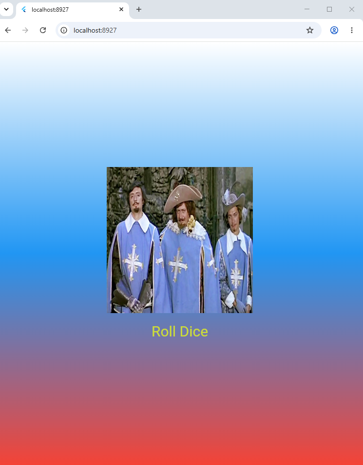

# Лабораторная работа №4-5. Flutter: структура UI и компонентный подход.
**Фамилия, имя:** Остапова Ульяна

**Группа:** ИСП-241

**Дата сдачи:** 25.10.2026

## Что изучено
- Постройка UI через дерево виджетов.
- Создание собственных виджет-классов.
- Разделение кода на отдельные файлы.
- передача данных между виджетами через параметры конструктора.

## Скриншот финального приложения


## Ссылка на репозиторий
[Ссылка на GitHub](https://github.com/Uliana-Ostapova/Flutter_Lab4.git)

## Инструкция по запуску
1. Клонировать репозиторий:
`git clone ссылка_на_репозиторий`
2. Перейти в папку проекта
`cd flutter_Lab4`
3. Выполнить
`flutter pub get`
4. Запустить приложение в браузере
`flutter run -d chrome`

## Ответы на вопросы
**1. Зачем выносить виджеты в отдельные файлы? Что изменится если держать всё в `main.dart`?**

Вынос файлов в отдельные файлы делает код более понятным и организованным. Если хранить всё в `main.dart`, файл станет большим и искать нужный код будет сложнее.

**2. Что такое `BuildContext`? Почему метод `build()` принимает его как параметр?**

`BuildContext` содержит информацию о положении виджета в дереве виджетов Flutter. Метод `build()` принимает `BuildContext` как параметр, потому что Flutter передаёт его автоматически, чтобы виджет мог получать информацию о своём месте в дереве виджетов и обращаться к окружающим его элементам интерфейса.

**3. Чем `StatelessWidget` отличается от `StatefulWidget`? Приведите пример когда нужен каждый из них.**

`StatelessWidget` используется для виджетов, состояние которых не меняется, например для статичного текста или фона:
```dart
class StyledText extends StatelessWidget {
  final String text;
  const StyledText(this.text, {super.key});
  @override
  Widget build(BuildContext context) {
    return Text(
      text,
      style: TextStyle(
        color: Colors.white,
        fontSize: 32,
      ),
    );
  }
}
```
`StatefulWidget` применяется когда интерфейс должен изменяться во время работы приложения. В данном приложении используется для смены изображения при нажатии на кнопку. Пример:
```dart
class DiceRoller extends StatefulWidget {
  const DiceRoller({super.key});

  @override
  State<StatefulWidget> createState() {
    return _DiceRollerState();
  }
}
```

**4. Почему `Random()` создаётся на уровне файла, а не внутри `rollDice()`?**

`Random()` создаётся на уровне файла, чтобы использовать один и тот же генератор случайных числе при каждом вызове метода `rollDice()`, вместо того чтобы создавать новый объект при каждом нажатии кнопки.